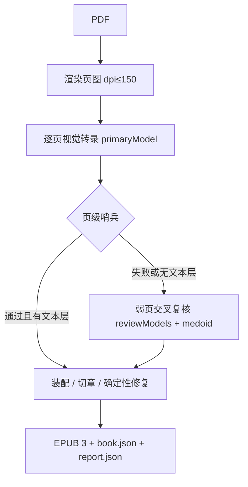

# dsh-pdf2epub

把整本 PDF 转成可重排 EPUB 3 的 DSH 插件：每页渲染成图交给视觉模型转录，弱页自动多模型交叉复核，逐页磁盘缓存可断点续跑，最后连 token 账单一起交代。

- **一本一目录**：一本书的全部产物落在 `<PDF 所在目录>/<PDF 文件名>/` 里——EPUB、两个 JSON 边车、`pages/` 页缓存、`images/` 插图。一起找得到，一起删得掉。
- **全自动**：给一个 PDF 就跑到底；坏页不阻塞成书，页级哨兵 + 交叉复核把可疑页标成 `degraded`，不假装通过。
- **可分批**：`pages` / `excludePages` 把 700 页的书拆成任意批次慢慢跑；页缓存与批次无关，最后全量跑一轮几乎零模型调用即可出书。
- **token 账单分账**：`report.tokens` 只记本次消耗，缓存命中的历史花费单独放在 `tokens.reused`。
- **`.epub` 直接在 DSH 里读**：文件树点开任意 `.epub` 走文档预览渲染器（`documentPreviews` 的 `epub` 扩展名），不需要外部阅读软件。

## 工作原理

PDF 按 `dpi`（有效上限 150）渲染成页图，每页一次视觉转录，模型按 `src/model/prompt.js` 的 14 条铁律返回结构化块（标题、段落、列表、表格、图注、脚注、页眉页脚等）。页级哨兵做确定性检查：块非空、无控制字符、单块不超过 12000 字符；该页有文本层且基线不少于 120 字符时，转录字数还须落在基线 ±15% 内。哨兵不过先在主模型上带问题重试一次；仍不过、或页面本就没有文本层，则交给 `reviewModels` 交叉复核，按字符相似度选 medoid，一致性低于 0.9 记 `degraded`。装配阶段再做确定性的修复（书眉逐页降级、页码 / 叶码清除、标点归一、标题层级 clamp、括号配对、跨页与跨家具续接），按 `splitLevel` 切章，写出 EPUB 3、`book.json` 和 `report.json`。

前 3 页按顺序跑：它们的页眉页脚给全书做提示，第 2、3 页还各自拿到上一页的结尾；其余页按 `concurrency` 并发。页与页没有依赖，所以缓存粒度就是页。



## 产物目录布局

一本一目录，目录名取自 PDF 文件名（去扩展名，按 Windows 规则清洗），默认就放在 PDF 旁边：

```text
<PDF 所在目录>/<PDF 文件名>/
    <PDF 文件名>.epub                              # 可重排 EPUB 3
    <PDF 文件名>.book.json                         # 阅读视图的数据源
    <PDF 文件名>.report.json                       # 质量报告 + token 账本
    pages/<dpi>-<provider>_<model>/00001.json …    # 逐页缓存，五位补零
    images/fig-<页码>-<序号>.png, cover.png        # 裁切出的插图与封面
```

`outputDir` 指到别处时，这个目录就落在那里。目录名和三个文件名共用清洗后的 `outputName`（非法字符换 `_`、去掉末尾点和空格、保留字加 `_`、上限 100 字符），真实取值写在 `report.book.outputName`，绝对路径写在 `report.book.directory`，是否就在 PDF 旁边写在 `report.book.alongsideInput`。

## 安装

本仓库是 DSH bundle（`package.json` 的 `dsh.bundle.patch` 指向 `cordis.patch.yml`），装上即启用：

1. DSH 的 Plugins 页点「添加插件」，选择本仓库目录；
2. 或让 agent 调 `plugin_manager`，`action: "install_bundle"`，`target` 指向本仓库绝对路径。

运行时依赖 `mupdf`（渲染与文本层）和 `fflate`（EPUB 打包），随插件安装。

**必须配置 `primaryModel` 才能转换。** 留空不阻止插件加载，面板照常出现；点「开始转换」时才报 `primaryModel is not configured`。单次调用传 `model` 可以覆盖配置。

## 配置项

配置在 `index.js` 的 `Config` 里声明；单次转换的同名字段优先于配置。

| 键 | 类型 | 默认 | 范围 | 说明 |
| --- | --- | --- | --- | --- |
| `primaryModel` | string | 空 | — | 主转录模型，`provider/model`，须支持图片输入 |
| `reviewModels` | string[] | `[]` | — | 弱页交叉复核模型；为空时弱页只标 `degraded` |
| `dpi` | integer | `150` | 72–300 | 页图渲染 DPI；有效值上限 150（平台把 A4 页缩到约 1092×1540），超出部分只记 `requestedDpi` |
| `maxTokens` | integer | `4000` | 512–16000 | 单页转录的输出上限 |
| `concurrency` | integer | `4` | 1–16 | 同时转录的页数（每批前 3 页仍顺序跑） |
| `splitLevel` | integer | `2` | 1–6 | 从哪级标题开始新章节 |
| `language` | string | `zh-CN` | — | 写入 EPUB 的语言标记 |
| `outputDir` | string | 空（PDF 所在目录） | — | 产物根目录，不存在会自动创建 |

数值经 `index.js` 归一化后再由 pipeline clamp 一次；传无法转成数字的值时落到区间下界。

## 两个使用入口

1. **侧边栏面板**：标题「PDF 转 EPUB」。填路径或点「浏览…」选 PDF →「开始转换」→ 徽标依次显示 排队中 / 渲染页面 / 转录中 / 组装 EPUB / 已完成（失败显示 失败，可「重试」，跑过后变「重新转换」）。旁边是页码进度、token 用量和耗时。「高级」里覆盖模型（读 `modelCatalog` 下拉，读不到回退手填）、复核模型、DPI、并发。完成后下方阅读区直接显示成书，可「收起阅读区」，有目录和上一章 / 下一章。
2. **agent 工具 `pdf2epub`**：对话里直接触发，同步等到成书才返回。

| 参数 | 类型 | 说明 |
| --- | --- | --- |
| `input` | string | 必填，PDF 路径（绝对，或相对工作目录） |
| `outputDir` | string | 产物根目录；缺省用配置，再缺省用 PDF 所在目录 |
| `model` | string | 覆盖 `primaryModel`，须支持图片输入 |
| `reviewModels` | string[] | 覆盖 `reviewModels`；空数组表示弱页只标 `degraded` |
| `dpi` | number | 72–300，有效值封顶 150；报告记 `requestedDpi` / `effectiveDpi` |
| `maxTokens` | number | 单页输出上限，512–16000 |
| `concurrency` | number | 同时转录页数，1–16 |
| `splitLevel` | number | 切章标题级别，1–6 |
| `pages` | string | 要转换的页，语法 `"1-5,31-35,73"`（1 起、逗号分隔、闭区间）；省略即全书 |
| `excludePages` | string | 要排除的页，语法同 `pages`；在 `pages` 之后生效（`pages: "1-3"` + `excludePages: "2"` 只转 1、3） |
| `cover` | boolean | 用第 1 页渲染封面 PNG（长边约 1400px）并声明为包封面；默认关 |
| `title` / `author` / `publisher` | string | 覆盖 EPUB 元数据；优先级为 调用方 > PDF 自身 `/Title`、`/Author` > 文件名 |
| `force` | boolean | 忽略页缓存全部重转 |

返回 `ok`、`epubPath`、`reportPath`、`bookJsonPath`、`pages`、`chapters`、`tokens{input,output,total}`、`degradedPages`。两个入口走同一条 `runConversion`，缓存、进度和报告一致；面板走后台作业（`POST /dsh-pdf2epub/run` 起作业，`GET /state` 读进度，`GET /book`、`GET /file` 读产物，`GET /epub` 解包任意 `.epub`）。页数硬上限 5000。

## 分批转写大书

`pages` / `excludePages` 是分批的基础：不在选择里的页既不会渲染也不会送模型，也不进 EPUB。页缓存**不含**页选择，缓存键是「这本书的第 N 页 + 这套设置」，所以

```text
pages: "1-40"  →  pages: "41-80"  →  …  →  pages: "1-764"
```

最后一次全量运行几乎不发模型调用，只是把已转写的页装配成书。选择表达式也接受全角数字、`，`、`、` 和全角/长破折号（中文输入法直接打出来的就是这些），越界或倒序会直接报错、不花模型调用。

**绝不能靠复制、改名、切片 PDF 来分批**：缓存指纹含绝对路径 + 文件大小 + mtime，动任一项就整本缓存作废，重烧全部 token。要排除下载站封面页之类的东西，用 `excludePages`，不要动文件。

## `.epub` 在 DSH 里阅读

文件树点开任意 `.epub`（文件 ≤64 MiB）即可：客户端注册 `documentPreviews` 的 `epub` 扩展名（`extensions` / `binaryExtensions` 均为 `['epub']`，`loading: 'renderer'`），宿主 `GET /dsh-pdf2epub/epub?path=…` 解包 OPF、spine 和 nav，返回标题、目录、章节 HTML、CSS 和图片。图片作为 data URL 内联（单图 ≤2 MiB、累计 ≤24 MiB、解压总量 ≤256 MiB，超预算的图跳过），客户端把书的样式作用到 `.p2e-book` 容器并按标签 / 属性白名单重建正文，正文与图片不发起外部请求。路径可绝对；工作区相对路径要带 `sessionId`，宿主按该会话工作目录解析。宿主没有 `documentPreviews` 服务时预览跳过，面板不受影响。

> **实测状态**：desktop profile 下从文件树或 `present` 卡片点开 `.epub` 可正常阅读（左侧目录、顶部书名作者、切目录后正文与高亮同步）；面板内嵌阅读区加载真实成书尚未验证。

## 产出物

| 文件 | 内容 |
| --- | --- |
| `<name>.epub` | 可重排 EPUB 3，可直接分发或用别的阅读器打开 |
| `<name>.book.json` | 阅读视图数据源：`{ title, author?, language, publisher?, cover, chapters: [{ id, title, level, html }] }`，与 EPUB 用同一批章节组装 |
| `<name>.report.json` | 逐页质量、模型、缓存与 token 账本 |
| `pages/<settings>/NNNNN.json` | 逐页缓存，断点续跑的中间产物 |
| `images/*.png` | 裁切的插图（`fig-<页码>-<序号>.png`）与封面（`cover.png`） |

## report 字段

顶层另有 `schema`（`dsh-pdf2epub/report@1`）、`generatedAt`、`input`、`outputs{epub,report,book}`、`bookJsonPath`、`limitations`。

| 字段 | 内容 |
| --- | --- |
| `book` | `title` / `author?` / `publisher?` / `language` / `pages` / `pagesSelected` / `chapters` / `cover` / `directory` / `outputName` / `alongsideInput`（`author`、`publisher` 缺失时 JSON 直接不出现该键） |
| `selection` | 全书运行时为 `null`；否则 `{ pages, excludePages, resolved: [...] }`，把批次报告对应回请求 |
| `models` | `primary` 与 `reviewers[]`，均为 `provider/model` |
| `stats` | `pagesTranscribed` / `pagesFromTextLayer` / `pagesCrossReviewed` / `pagesDegraded` / `pagesFailed` / `pagesBlank` / `pagesEmpty` / `pagesUnparsable` / `pagesTransportFailed` / `pagesReasoningBudget` / `blocks` / `blocksDropped` / `demotedHeadings` / `blocksJoined` / `blocksRejectedJoins` / `chapters` / `figuresExtracted` |
| `tokens` | `input` / `output` / `cached` / `cacheWrite` / `reasoning` / `total` / `calls` / `estimated` / `reused` / `byPage[]`。`cached`/`cacheWrite` 是模型侧提示词缓存，与页缓存无关；页缓存省下的历史消耗在 `reused`（未实际发生的消耗）；`byPage[].cached` 标出本次没花钱的页 |
| `rendering` | `requestedDpi` / `effectiveDpi` / `maxEffectiveDpi` / `note` |
| `timing` | `totalMs` |
| `warnings` | 字符串数组，见下 |
| `pages` | 逐页，见下 |

`stats.pagesFailed` 统计没产出正文的页（空块、带 `error`、只剩页眉页脚），不是「调用抛异常」。`pagesBlank` 是真空白页（实测墨迹低于页面 0.5%），不计失败、也不进 `pagesEmpty`。`demotedHeadings` 是因同页书眉而降级的 `h1`/`h2` 数（缺陷被识别，而不是被静默吞掉）。`figuresExtracted` 是真正嵌入的图片数，只有图注的图不算。

`warnings` 里可能出现的几类：页失败的汇总句（最多列 10 个页码 + 归因，并说明失败页没进缓存、重跑会重试）、推理预算专用建议、逐条插图裁切回落、路径类（旧缓存迁移、封面落盘失败、封面渲染失败），以及「未产出书」那份报告独有的一句声明。

`pages[]` 逐页字段：`page` / `source` / `chars` / `baselineChars` / `ratio` / `ok` / `reviewed` / `degraded` / `agreement` / `models` / `finishKind` / `truncated` / `reasoningChars` / `image` / `issues` / `figures` / `failure` / `blank` / `error` / `raw` / `ms`。

- `failure` 五值：`empty-blocks`（答了但 `blocks` 为空）、`unparsable`（回复没解析成 JSON）、`transport`（调用本身失败：限流、超时、空流）、`reasoning-budget`（预算全被 thinking 吃掉，没有答案）、`blank-page`（实测真空白，`ok` 为 `true` 且会进缓存）；正常页为 `null`。
- `raw` 只在没产出正文的页上出现，是模型回复开头 400 字符；健康页不存，避免报告变成书的副本。
- `reasoningChars` 每页都有：thinking 到底跑了没有、跑了多少字，这是推理挤掉答案时唯一的痕迹。

## 失败诊断

整本都没产出正文时，进程会**先**写出 `<bookDir>/<name>.report.json` 再抛错，错误信息末尾带 `; diagnostics written to <绝对路径>`。那份报告与成功报告同结构（`chapters: []`、`outputs.book` 为 `null`、`warnings` 里多一句声明），逐页保留 `failure` 分类和 `raw` 摘录，所以「模型没说话」「说的不是 JSON」「调用挂了」「被推理挤掉」事后可分辨。失败页**不入缓存**，重跑会自动重试（唯一的例外是 `blank-page`：空白本来就是答案，缓存它不再花钱）。

## 缓存与重跑

位置：`<bookDir>/pages/<dpi>-<provider>_<model>/NNNNN.json`（五位补零页码）。

- **缓存键**：输入指纹（绝对路径 + 文件大小 + mtime，sha256 前 12 位）+ 设置指纹（生效 dpi + 主模型 `provider/model`）+ `PROMPT_VERSION`（当前 `4`，提示词或块 schema 改动时递增）。
- **校验方式**：目录名只带设置指纹；输入指纹与提示词版本写在每条记录里（`{ version, dpi, model, input, page, ledger, furniture }`），读回时逐项校验，不符即删掉该条并按未命中重转（自愈）。所以「同名不同书」的隔离靠 payload 校验而不是目录名：两本同名的 PDF 共用一个目录，后跑的那本会覆盖前一本的页缓存——这是「目录要人找得到」的刻意取舍。
- **写入条件**：只有产出正文的页才写（`blank-page` 例外，记 `blank: true`）；失败页、空页、只剩页眉页脚的页一律不写。
- **旧布局迁移**：老版本的 `<outputDir>/.pdf2epub-<inputKey>/pages/` 会在新建书目录时被搬进来，失败只记一条 `warnings`，不会中断转换。
- **`force: true`** 跳过读取，全部重转。

## 已知限制

- **插图只在模型给出可用 bbox 时裁切**：`figure` 块带 `bbox`（归一化四元组）才会按图裁进 EPUB；没有 bbox、bbox 越界或裁切失败时只保留图注，并在 `warnings` 留一行。页图本身永远不整页嵌入。
- **扫描件无文本层**，每页都会被判为弱页：配了 `reviewModels` 就是每页都交叉复核，成本 2–3 倍。**不建议给扫描书配 `reviewModels`**，把复核预算留给抽样质检。
- **模型关不掉 thinking 的路由**（如 `opencode-go/deepseek-v4.1-flash`）会给推理留 16384 的预算余量，答案仍可能被推理挤掉（记 `reasoning-budget`）；此时唯一的旋钮是调高 `maxTokens`。
- **目录页与正文章题不一致时**，只有带印刷页码的条目会按最近的章标题校正（编辑距离 ≤2、长度差 ≤3；两个标题等距并列则不猜，保留原文）。
- **公式未特殊处理**：没有 MathML / OMML 通道，只能按纯文本近似。
- **未支持加密 PDF**：报 `PDF is password protected: <路径>`。
- **未支持 EPUB2 NCX**：阅读视图按 EPUB 3 nav 解析目录，没有 nav 时回退用 spine 生成。

## 测试

```bash
npm test             # 逻辑层 + EPUB + 加固 + e2e（4 套）
npm run test:harness # 宿主路由 / 客户端 / 预览 / 模型选择 / 文件选择器 / 安全（9 套）
```

`npm test`：`src/model/test.mjs`（51）、`src/epub/test.mjs`（30）、`src/epub/hardening.test.mjs`（30）、`test/e2e.mjs`（50 场景 507 检查）。
`npm run test:harness`：`host-check`（43）、`epub-route-check`（18）、`client-check`（16）、`locale-check`（5）、`preview-check`（11）、`route-path`（10）、`security-check`（76，本机无 Edge/Chrome 时浏览器层 SKIP）、`model-select-check`、`picker-check`（后两者只打印 OK，不打条数）。脚本在 `test/harness/`，产物写 `.out/`（已 gitignore）；需要样例书的脚本用 `src/epub/build.js` 运行时自建。`pretest`（`node src/pdf/smoke.mjs`）生成 e2e 需要的 `.out/test.pdf` 与 `.out/test-long.pdf`。

## 许可证

本项目以 **Apache-2.0** 发布（见 `LICENSE`）。

核心依赖 `mupdf`（MuPDF.js，Artifex Software）是 **AGPL-3.0-or-later**，与本项目许可不同。因此**再分发包含该依赖的产物时须遵守 AGPL**（例如把插件和 `node_modules` 一起打包分发）。本仓库自身不含 mupdf 源码或二进制，它由用户 `npm install` 时安装。第三方组件清单与各自许可见 `NOTICE`。

若在意许可证兼容性，可替换渲染后端：`src/pdf/index.js` 是对 mupdf 的唯一耦合点。
