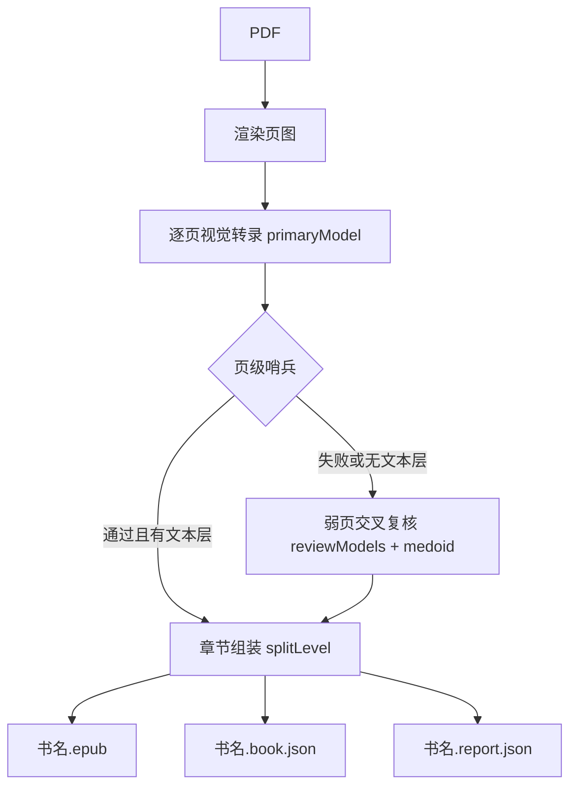

# dsh-pdf2epub

把整本 PDF 转成可重排 EPUB 3 的 DSH 插件：每页渲染成图交给视觉模型转录，弱页自动多模型交叉复核，最后连 token 账单一起交代。

- **全自动无人值守**：给一个 PDF 就跑到底，产出 `<书名>.epub`、`<书名>.book.json`、`<书名>.report.json`；逐页磁盘缓存，中断后重跑接着来。
- **坏页多模型交叉复核**：页级哨兵不通过、或该页没有文本层时，用 `reviewModels` 追加转录并按字符相似度取 medoid；一致性不足标 `degraded`，不假装通过。
- **token 账单分清「本次消耗」与「缓存复用」**：`report.tokens` 只记本次运行的花费（模型不报用量时按估算并标 `estimated`），缓存命中的历史花费单独放在 `tokens.reused`，`tokens.byPage[].cached` 标出没花钱的页。
- **`.epub` 直接在 DSH 里点开阅读**：文件树点任意 `.epub` 走文档预览渲染器，宿主解包、客户端渲染，不需要外部阅读软件。

## 工作原理

PDF 按 `dpi`（有效上限 150）渲染成页图，每页一次视觉转录，模型返回结构化块（标题、段落、列表、表格、图注、页眉页脚等）。页级哨兵做确定性检查：块非空、无控制字符、单块不超过 12000 字符；该页有文本层且基线不少于 120 字符时，转录字数还须落在基线 ±15% 内。哨兵不过先在主模型上带问题重试一次；仍不过、或页面本就没有文本层，则交给 `reviewModels` 交叉复核，用字符相似度选 medoid，一致性低于 0.9 记 `degraded`。通过后去掉页眉页脚，按 `splitLevel` 组装章节，写出 EPUB 3、阅读视图用的 `book.json` 和 `report.json`。前 3 页按顺序跑，用它们的页眉页脚给全书做提示，第 2、3 页还各自拿到上一页的结尾；其余页按 `concurrency` 并发。



## 安装

本仓库是 DSH bundle（`package.json` 的 `dsh.bundle.patch` 指向 `cordis.patch.yml`），装上即启用：

1. 打开 DSH 的 Plugins 页，点「添加插件」，选择本仓库目录；
2. 或让 agent 调 `plugin_manager`，`action: "install_bundle"`，`target` 指向本仓库绝对路径。

运行时依赖 `mupdf`（渲染与文本层）和 `fflate`（EPUB 打包），随插件安装。

**必须配置 `primaryModel` 才能转换。** 留空不会阻止插件加载，面板照常出现；点「开始转换」时才报 `primaryModel is not configured`。单次调用里传 `model` 可以覆盖配置。

## 配置项

配置键在 `index.js` 的 `Config` 中声明；单次转换里给出的同名字段（`model`、`reviewModels`、`dpi` 等）优先于配置。

| 键 | 类型 | 默认 | 范围 | 说明 |
| --- | --- | --- | --- | --- |
| `primaryModel` | string | 空 | — | 主转录模型，`provider/model`，须支持图片输入 |
| `reviewModels` | string[] | `[]` | — | 弱页交叉复核模型；为空时弱页只标 `degraded` |
| `dpi` | integer | `150` | 72–300 | 页图渲染 DPI；有效值上限 150（平台把 A4 页缩到约 1092×1540），超出部分只记 `requestedDpi` |
| `maxTokens` | integer | `4000` | 512–16000 | 单页转录的输出上限 |
| `concurrency` | integer | `4` | 1–16 | 同时转录的页数（前 3 页仍顺序跑） |
| `splitLevel` | integer | `2` | 1–6 | 从哪级标题开始新章节 |
| `language` | string | `zh-CN` | — | 写入 EPUB 的语言标记 |
| `outputDir` | string | 空（PDF 所在目录） | — | 产物目录，不存在会自动创建 |

配置值先经 `index.js` 归一化（缺失项取默认，数值夹取），pipeline 对单次调用参数再做一次 clamp；传入无法转成数字的值时落到区间下界。

## 两个使用入口

1. **侧边栏面板**：面板标题「PDF 转 EPUB」。填「输入 PDF 路径」→「开始转换」→ 状态徽标依次显示 排队中 / 渲染页面 / 转录中 / 组装 EPUB / 已完成（失败显示 失败），旁边是页码进度、token 用量和耗时；完成后下方阅读区直接显示成书（可「收起阅读区」），有目录和上一章 / 下一章，← / → 翻章。出错时可「重试」，跑过一次后按钮变为「重新转换」。「高级」里可覆盖模型、复核模型、DPI、并发。
2. **agent 工具 `pdf2epub`**：对话里直接触发。参数 `input`（必填）、`outputDir`、`model`、`reviewModels`、`dpi`、`maxTokens`、`concurrency`、`splitLevel`、`force`；返回 `ok`、`epubPath`、`reportPath`、`bookJsonPath`、`pages`、`chapters`、`tokens{input,output,total}`、`degradedPages`。

两者走同一条 `runConversion`，缓存、进度和报告一致。面板的转换走后台作业（`POST /dsh-pdf2epub/run` 起作业，`GET /state` 读进度，`GET /book`、`GET /file` 读产物，`GET /epub` 解包任意 `.epub`）；工具调用则等到 EPUB 写好才返回。页数硬上限 5000。

## `.epub` 在 DSH 里阅读

文件树里点开任意 `.epub`（文件 ≤64 MiB）即可：客户端注册 `documentPreviews` 的 `epub` 扩展名（`loading: 'renderer'`），宿主 `GET /dsh-pdf2epub/epub?path=…` 解包 OPF、spine 和 nav，返回标题、目录、章节 HTML、CSS 和图片；图片作为 data URL 内联（单图 ≤2 MiB，累计 ≤24 MiB，超出预算的图跳过或不再内联），客户端把书的样式作用到 `.p2e-book` 容器并按标签/属性白名单重建正文，正文与图片不发起外部请求。路径可以是绝对路径；工作区相对路径要带 `sessionId`，宿主按该会话的工作目录解析。宿主没有 `documentPreviews` 服务时预览会跳过，面板不受影响。

> **未验证**：这条阅读路径没有在真实 GUI 里点开验证过（插件尚未装进运行中的 profile）；面板「开始转换」→ 后台作业 → 在面板里打开成书的链路，以及工具在真实宿主里的一次完整转换，同样没有活体验证。

## 产出物

`<书名>` 是输入 PDF 的文件名主干，三个文件都写进 `outputDir`：

| 文件 | 内容 |
| --- | --- |
| `<书名>.epub` | 可重排 EPUB 3，可直接分发或用别的阅读器打开 |
| `<书名>.book.json` | 阅读视图的数据源：`{ title, author, language, chapters: [{ id, title, level, html }] }`，与 EPUB 用同一批章节组装 |
| `<书名>.report.json` | 逐页质量、模型、缓存与 token 账本 |

## report 字段

报告顶层另有 `schema`（`dsh-pdf2epub/report@1`）、`generatedAt`、`input`、`outputs{epub,report,book}`、`bookJsonPath`、`limitations`。

| 字段 | 内容 |
| --- | --- |
| `book` | `title` / `author` / `language` / `pages` / `chapters` |
| `models` | `primary` 与 `reviewers[]`，均为 `provider/model` |
| `stats` | `pagesTranscribed` / `pagesFromTextLayer` / `pagesCrossReviewed` / `pagesDegraded` / `pagesFailed` / `blocks` / `blocksDropped` / `blocksJoined` / `blocksRejectedJoins` / `chapters` |
| `tokens` | `input` / `output` / `cached` / `cacheWrite` / `reasoning` / `total` / `calls` / `estimated`，**只记本次运行的消耗**（`estimated: true` 表示其中含估算）；`cached`/`cacheWrite` 是模型侧提示词缓存的读写 token，与页缓存无关；页缓存省下的历史消耗在 `reused`，`byPage[]` 的 `{ page, chars, models, cached }` 标出哪页走了缓存 |
| `timing` | `totalMs` |
| `rendering` | `requestedDpi` / `effectiveDpi` / `maxEffectiveDpi` / `note` |
| `warnings` | 字符串数组；有页没产出正文时写一句带页码的提醒（最多列 10 个），说明失败页没进缓存、重跑会重试 |
| `pages` | 逐页：`page` / `source` / `chars` / `baselineChars` / `ratio` / `ok` / `reviewed` / `degraded` / `agreement` / `models` / `finishKind` / `truncated` / `image` / `issues` / `error` / `ms` |

`stats.pagesFailed` 统计的是没产出正文的页（空块、带 `error`、只剩页眉页脚），不是「调用抛异常」；这类页不写缓存。`runConversion` 的返回值里另带 `pagesFailed`，与 `report.stats.pagesFailed` 同值。

## 缓存与重跑

缓存目录是 `<outputDir>/.pdf2epub-<inputKey>/pages/<dpi>-<model>/NNNNN.json`：`inputKey` 是输入指纹（绝对路径 + 文件大小 + mtime）的 sha256 前 12 位，`<dpi>-<model>` 是设置指纹。缓存键还包含 `PROMPT_VERSION`（当前 2，写在每条记录里校验）。只有真正产出正文的页才写缓存；失败页、空页、只剩页眉页脚的页不写，重跑会自动重试。`force: true` 跳过缓存全部重转。命中缓存不产生本次消耗，历史花费进 `tokens.reused`。

## 已知限制

- **插图只保留图注**：`figure` 块带的是图注文字，页面插图本身不抽取（`report.limitations.images`）。
- **扫描件没有文本层**：拿不到字数基线，一律按弱页处理：配了 `reviewModels` 就追加复核、更费 token；没配则没有第二意见，只有主模型输出（哨兵不过时先重试一次），有问题也只会标 `degraded`。
- **公式未特殊处理**：没有 MathML 或图片通道，只能按纯文本近似。
- **未支持加密 PDF**：带密码的 PDF 打不开，报 `PDF is password protected`。
- **未支持 EPUB2 NCX**：`.epub` 阅读视图按 EPUB 3 nav 解析目录，没有 nav 时回退用 spine 生成。

## 测试

```bash
npm test             # 逻辑层 + EPUB + 加固 + e2e（4 套）
npm run test:harness # 宿主路由 / 客户端 / 预览 / 安全（7 套）
```

`npm test`：`src/model/test.mjs`（51）、`src/epub/test.mjs`（30）、`src/epub/hardening.test.mjs`（30）、`test/e2e.mjs`（7 场景 71 检查）。
`npm run test:harness`：`host-check`（宿主路由与作业状态机，34）、`epub-route-check`（`/epub` 路由，18）、`client-check`（16）、`locale-check`（5）、`preview-check`（11）、`route-path`（路径解析，10）、`security-check`（安全过滤，76；本机没有 Edge/Chrome 时浏览器层打印 SKIP 并跳过）。自测脚本在 `test/harness/`，产物一律写进 `.out/`（已被 `.gitignore` 忽略），两个需要样例书的脚本会用 `src/epub/build.js` 运行时自建。

`test/e2e.mjs` 需要的 `.out/test.pdf` 与 `.out/test-long.pdf` 由 `npm test` 的 `pretest`（`node src/pdf/smoke.mjs`）自动生成，无需手动准备。

## 许可证

本项目以 **Apache-2.0** 发布（见 `LICENSE`）。

核心依赖 `mupdf`（MuPDF.js，Artifex Software）是 **AGPL-3.0-or-later**，与本项目许可不同。因此**再分发包含该依赖的产物时须遵守 AGPL**（例如把插件和 `node_modules` 一起打包分发）。本仓库自身不含 mupdf 源码或二进制，它由用户 `npm install` 时安装。第三方组件清单与其各自许可见 `NOTICE`。

若在意许可证兼容性，可替换渲染后端：`src/pdf/index.js` 是对 mupdf 的唯一耦合点。
